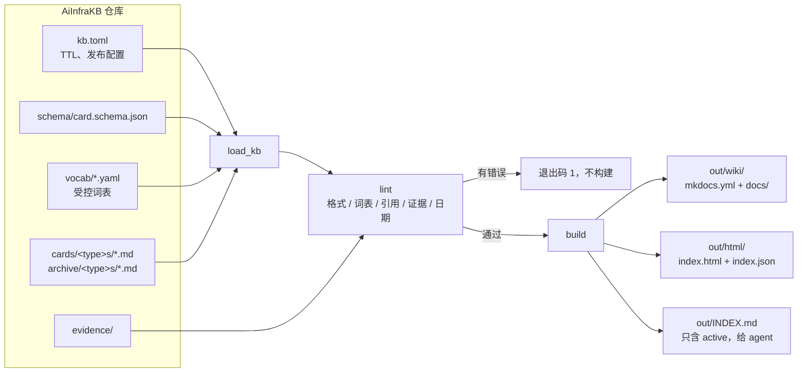
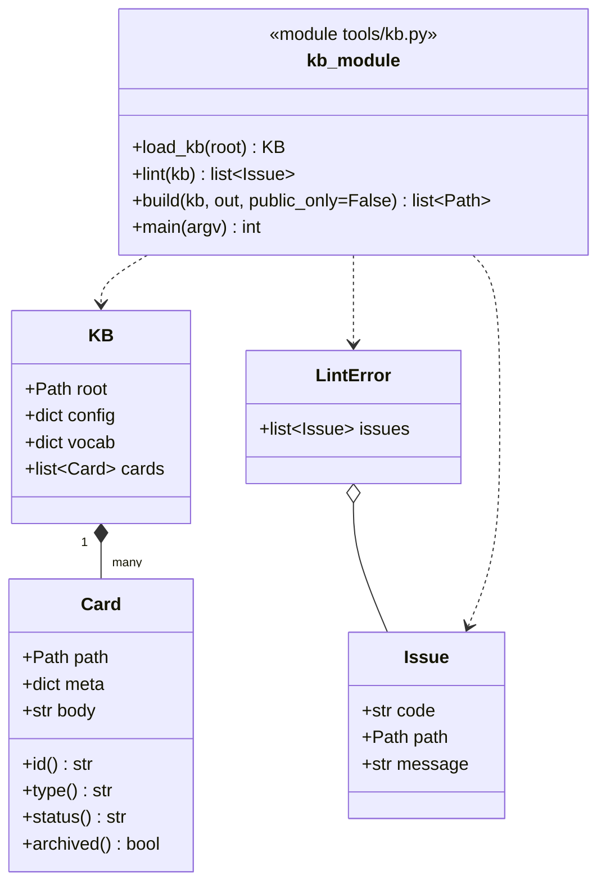

# AiInfraKB 架构

AiInfraKB 是给 agent 用的 AI 推理优化知识库：每条知识是一张卡片，写明结论、适用条件和证据；人看的 Wiki 和 HTML 索引都从卡片生成。

## 数据流

P0 只有 `lint` 和 `build`。`query`、`propose`、`feedback`（P1）和治理扫描（P2）在同一个 `KB` 对象上扩展，不改卡片格式。

## 类图

- `load_kb` 读取 `cards/` 和 `archive/` 下的所有 `.md`，把 YAML 解析出的日期统一转成 `YYYY-MM-DD` 字符串后再交给 schema 校验。
- `build` 先调用 `lint`，有任何 `Issue` 就抛出 `LintError`。
- `public_only=True` 时，`visibility` 不是 `public` 的卡片不出现在任何产物里。

## lint 规则

| 代码 | 规则 |
|---|---|
| `E_SCHEMA` | frontmatter 不满足 `schema/card.schema.json`（缺字段、枚举值错、格式错） |
| `E_DUP_ID` | 卡片 id 重复 |
| `E_FILENAME` | 文件名（不含 `.md`）不等于 id |
| `E_TYPE_DIR` | 所在目录不是 `<type>s/`（如 `lesson` 必须在 `lessons/`） |
| `E_ARCHIVE_STATUS` | `archive/` 下的卡片状态不是 `deprecated` 或 `superseded` |
| `E_VOCAB` | `applies_to` 里的硬件、软件、模型、技巧不在词表中 |
| `E_CLAIM_NUMBER` | `lesson`、`technique`、`benchmark` 的 `claim` 里没有数字 |
| `E_ACTIVE_EVIDENCE` | `active` 卡片没有证据，或置信度是 `inferred` |
| `E_DATES` | `created` 晚于 `last_verified`，或 `review_by` 早于 `last_verified` |
| `E_REF` | `related`、`supersedes`、`superseded_by` 指向不存在的 id |
| `E_SUPERSEDED` | `superseded` 状态缺少 `superseded_by` |
| `E_EVIDENCE_PATH` | 证据 `ref` 是仓库内路径但文件不存在（`http(s)://` 链接不检查） |
| `E_SECTIONS` | 正文缺少 `## 结论`、`## 适用条件`、`## 证据` 任一节 |

## build 产物

| 路径 | 内容 |
|---|---|
| `out/wiki/mkdocs.yml` | MkDocs 配置，站点名取 `kb.toml` 的 `publish.site_title` |
| `out/wiki/docs/index.md` | 总览：按类型、状态计数 |
| `out/wiki/docs/cards/<id>.md` | 每张卡一页；顶部写状态、置信度、最后验证日期；非 `active` 状态加 `!!! warning` 横幅 |
| `out/wiki/docs/by-hardware/<name>.md`、`by-model/`、`by-technique/` | 按维度列出卡片 |
| `out/html/index.json` | 门户兼容格式：`title`、`description`、`items[]`，每项含 `id`、`title`、`summary`（claim）、`tags`、`date`（last_verified）、`url`（`publish.wiki_base_url` + `cards/<id>/`）、`status`、`type` |
| `out/html/index.html` | 单页索引，读取 `index.json`，可按关键字和状态过滤 |
| `out/INDEX.md` | 给 agent 的精简目录，只列 `active` 卡片，按类型分组 |
