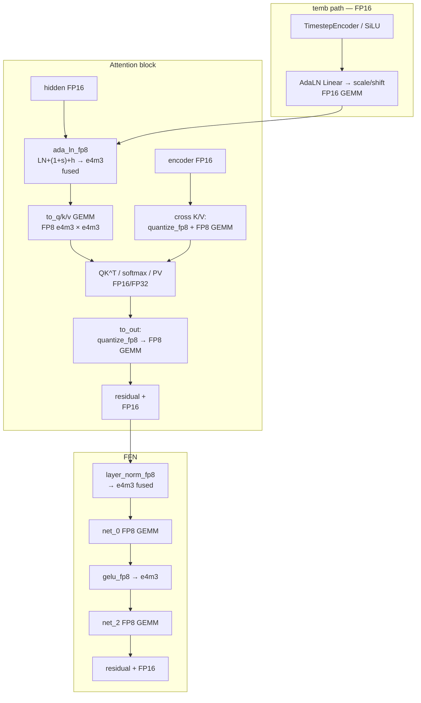

# GR00T DiT FP8 精度门报告（phase_ada_ln）

- 日期：2026-10-14
- 范围：**仅 DiT denoise**（ViT / action head / LLM 不在本报告）
- 对拍：`chameleon.evaluate.gr00t_stage_compare` action_head vs PT `gr00t_n17_xdof_fp16_v2_vit_llm_flash`
- 门限：dims **0–31** cos **≥0.999** 且 mse **<1e-4**
- 主包：`gr00t_n17_dit_fp8_full_dit_phase_ada_ln_unirt`（Phase A+B+LN_FP8+ada_ln_fp8）
- 对照：`phase_b_ln`（无 ada_ln）、`qkv24`（精度交付候选）
- 数据：`fp8_*_gate_with_mabs.json`（从 compare dump 重算 mean_abs）

## Overall（dims 0–31）

| 包 | pass | cosine | mse | mean_abs |
|---|---:|---:|---:|---:|
| qkv24 | **32/32** | 0.999992 | 2.830e-06 | 1.284e-03 |
| phase_b_ln | **26/32** | 0.999953 | 1.598e-05 | 2.670e-03 |
| **phase_ada_ln** | **26/32** | 0.999935 | 2.191e-05 | 2.800e-03 |

## phase_ada_ln FAIL dims

| dim | cos | mse | mean_abs |
|---:|---:|---:|---:|
| 0 | 0.998986 | 1.537e-05 | 3.547e-03 |
| 8 | 0.998774 | 1.547e-05 | 3.359e-03 |
| 18 | 0.998576 | 4.523e-04 | 2.002e-02 |
| 20 | 0.997761 | 4.343e-06 | 1.660e-03 |
| 23 | 0.997277 | 1.313e-05 | 2.997e-03 |
| 25 | 0.998755 | 7.164e-06 | 2.262e-03 |

重叠 FAIL（vs phase_b_ln）：**0, 8, 18, 20, 23**（ada 多 25、少 21）。结论：非 ada_ln 独有回归。

## Per-dim 0–31（phase_ada_ln 主表）

| dim | cos | mse | mean_abs | gate |
|---:|---:|---:|---:|:---:|
| 0 | 0.998986 | 1.537111e-05 | 3.546902e-03 | ❌ |
| 1 | 0.999942 | 4.828449e-06 | 1.803599e-03 | ✅ |
| 2 | 0.999959 | 8.259395e-06 | 2.247671e-03 | ✅ |
| 3 | 0.999998 | 3.749656e-06 | 1.720490e-03 | ✅ |
| 4 | 0.999599 | 9.044951e-06 | 2.332243e-03 | ✅ |
| 5 | 0.999684 | 1.989052e-05 | 3.933493e-03 | ✅ |
| 6 | 0.999636 | 1.177266e-05 | 2.710450e-03 | ✅ |
| 7 | 0.999999 | 2.139400e-06 | 1.246649e-03 | ✅ |
| 8 | 0.998774 | 1.547153e-05 | 3.359043e-03 | ❌ |
| 9 | 0.999730 | 6.380449e-06 | 1.939548e-03 | ✅ |
| 10 | 0.999860 | 6.664681e-06 | 1.984519e-03 | ✅ |
| 11 | 0.999937 | 9.195410e-06 | 2.655567e-03 | ✅ |
| 12 | 0.999998 | 3.638458e-06 | 1.478487e-03 | ✅ |
| 13 | 0.999889 | 6.925974e-06 | 2.245222e-03 | ✅ |
| 14 | 0.999952 | 5.553564e-06 | 1.883326e-03 | ✅ |
| 15 | 0.999822 | 7.954172e-06 | 2.225040e-03 | ✅ |
| 16 | 0.999998 | 3.049324e-06 | 1.368591e-03 | ✅ |
| 17 | 0.999551 | 8.330305e-06 | 2.292826e-03 | ✅ |
| 18 | 0.998576 | 4.522661e-04 | 2.001911e-02 | ❌ |
| 19 | 0.999995 | 1.013230e-05 | 2.573650e-03 | ✅ |
| 20 | 0.997761 | 4.343136e-06 | 1.660221e-03 | ❌ |
| 21 | 0.999114 | 1.381617e-05 | 2.955141e-03 | ✅ |
| 22 | 0.999919 | 8.453714e-06 | 2.273421e-03 | ✅ |
| 23 | 0.997277 | 1.313479e-05 | 2.996785e-03 | ❌ |
| 24 | 0.999753 | 7.436242e-06 | 1.902108e-03 | ✅ |
| 25 | 0.998755 | 7.164255e-06 | 2.261687e-03 | ❌ |
| 26 | 0.999455 | 5.155888e-06 | 1.809084e-03 | ✅ |
| 27 | 0.999963 | 1.050884e-05 | 2.866400e-03 | ✅ |
| 28 | 0.999858 | 6.758735e-06 | 2.102959e-03 | ✅ |
| 29 | 0.999336 | 5.712859e-06 | 1.987384e-03 | ✅ |
| 30 | 0.999834 | 3.402520e-06 | 1.517673e-03 | ✅ |
| 31 | 0.999634 | 4.617942e-06 | 1.712806e-03 | ✅ |

## Per-dim 对照摘要（phase_b_ln / qkv24）

| dim | ada cos | ln cos | qkv cos | ada mabs | ln mabs | qkv mabs |
|---:|---:|---:|---:|---:|---:|---:|
| 0 | 0.998986 | 0.998545 | 0.999852 | 3.547e-03 | 4.050e-03 | 1.186e-03 |
| 1 | 0.999942 | 0.999932 | 0.999980 | 1.804e-03 | 2.048e-03 | 1.068e-03 |
| 2 | 0.999959 | 0.999958 | 0.999990 | 2.248e-03 | 2.468e-03 | 1.343e-03 |
| 3 | 0.999998 | 0.999999 | 0.999999 | 1.720e-03 | 1.673e-03 | 1.283e-03 |
| 4 | 0.999599 | 0.999569 | 0.999861 | 2.332e-03 | 2.515e-03 | 1.324e-03 |
| 5 | 0.999684 | 0.999736 | 0.999891 | 3.933e-03 | 3.292e-03 | 1.276e-03 |
| 6 | 0.999636 | 0.999623 | 0.999870 | 2.710e-03 | 2.513e-03 | 1.393e-03 |
| 7 | 0.999999 | 0.999999 | 1.000000 | 1.247e-03 | 1.073e-03 | 7.314e-04 |
| 8 | 0.998774 | 0.998164 | 0.999652 | 3.359e-03 | 3.864e-03 | 1.722e-03 |
| 9 | 0.999730 | 0.999645 | 0.999887 | 1.940e-03 | 2.145e-03 | 1.134e-03 |
| 10 | 0.999860 | 0.999903 | 0.999958 | 1.985e-03 | 2.288e-03 | 1.346e-03 |
| 11 | 0.999937 | 0.999937 | 0.999976 | 2.656e-03 | 2.459e-03 | 9.360e-04 |
| 12 | 0.999998 | 0.999998 | 0.999999 | 1.478e-03 | 1.567e-03 | 9.070e-04 |
| 13 | 0.999889 | 0.999882 | 0.999907 | 2.245e-03 | 2.017e-03 | 1.673e-03 |
| 14 | 0.999952 | 0.999944 | 0.999963 | 1.883e-03 | 2.223e-03 | 1.558e-03 |
| 15 | 0.999822 | 0.999778 | 0.999886 | 2.225e-03 | 2.410e-03 | 1.337e-03 |
| 16 | 0.999998 | 0.999999 | 0.999999 | 1.369e-03 | 1.409e-03 | 8.118e-04 |
| 17 | 0.999551 | 0.999673 | 0.999892 | 2.293e-03 | 2.067e-03 | 1.279e-03 |
| 18 | 0.998576 | 0.999200 | 0.999957 | 2.002e-02 | 1.475e-02 | 3.675e-03 |
| 19 | 0.999995 | 0.999994 | 0.999999 | 2.574e-03 | 2.805e-03 | 1.181e-03 |
| 20 | 0.997761 | 0.997692 | 0.999172 | 1.660e-03 | 1.826e-03 | 1.014e-03 |
| 21 | 0.999114 | 0.998930 | 0.999712 | 2.955e-03 | 3.493e-03 | 1.903e-03 |
| 22 | 0.999919 | 0.999891 | 0.999981 | 2.273e-03 | 2.846e-03 | 1.123e-03 |
| 23 | 0.997277 | 0.997781 | 0.999549 | 2.997e-03 | 2.567e-03 | 1.198e-03 |
| 24 | 0.999753 | 0.999767 | 0.999947 | 1.902e-03 | 1.488e-03 | 9.599e-04 |
| 25 | 0.998755 | 0.999131 | 0.999606 | 2.262e-03 | 1.791e-03 | 1.096e-03 |
| 26 | 0.999455 | 0.999588 | 0.999839 | 1.809e-03 | 1.555e-03 | 9.736e-04 |
| 27 | 0.999963 | 0.999955 | 0.999982 | 2.866e-03 | 2.847e-03 | 1.097e-03 |
| 28 | 0.999858 | 0.999872 | 0.999971 | 2.103e-03 | 1.920e-03 | 9.743e-04 |
| 29 | 0.999336 | 0.999305 | 0.999654 | 1.987e-03 | 1.996e-03 | 1.382e-03 |
| 30 | 0.999834 | 0.999687 | 0.999886 | 1.518e-03 | 2.061e-03 | 1.263e-03 |
| 31 | 0.999634 | 0.999714 | 0.999894 | 1.713e-03 | 1.420e-03 | 9.406e-04 |

## DiT denoise 精度图

见图：`/workspace/gr00t-dit-fp8-precision-map.png`（LT5 shared: `~/shared/gr00t-fp8/gr00t-dit-fp8-precision-map.png`）（仅当前 phase_ada_ln / full_dit 栈；非整模）。

### 图例

| 颜色/类别 | 含义 |
|---|---|
| 绿 fused e4m3-out | `ada_ln_fp8` / `gelu_fp8` / `layer_norm_fp8`（激活直接出 e4m3） |
| 橙 FP8 GEMM | `FP8Linear.forward_prequantized`（QKV / to_out / FFN） |
| 黄 显式 quantize_fp8 | cross-KV、to_out 入口（仍留税） |
| 蓝 FP16/FP32 | temb Linear、attn softmax 路径、residual add、layout |
| 灰 排除 | ViT / LLM / action head（本图不画） |

## 一句话

phase_ada_ln **26/32**（overall cos 0.999935 / mse 2.19e-5 / mabs 2.80e-3）；与 LN 同档；qkv24 仍 **32/32**。
